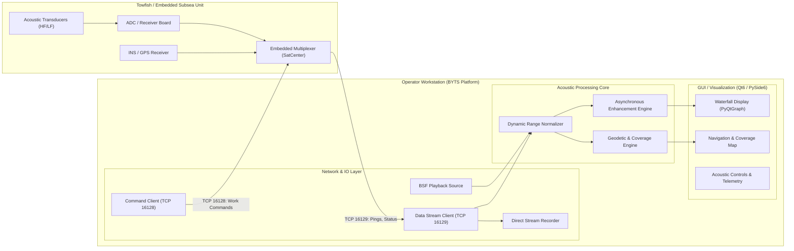
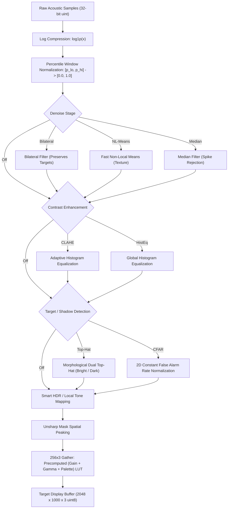

# BYTS / BYTT Side-Scan Sonar System
## Comprehensive Technical Specification & System Architecture

**Document Version:** 1.0  
**Status:** Implemented Reference Specification  
**Platform:** Python 3.11+ / PySide6 (Qt 6) / pyqtgraph / OpenCV  

---

## 1. System Overview & Physical Context

The **BYTS / BYTT** system is an integrated hydrographic survey, data acquisition, and acoustic imaging platform. It interfaces with a dual-channel (port and starboard) side-scan sonar towfish equipped with integrated inertial navigation (INS/GPS).

The system operates across two operational domains:
1. **Live Acquisition Mode**: High-throughput, concurrent TCP streaming from the towfish network interface with real-time hardware telemetry, command sequencing, and bit-level recording.
2. **Playback & Post-Mission Analysis Mode**: Deterministic replay of recorded `.bsf` (Binary Sonar File) containers with file-wide dynamic range calibration, frame seeking, and post-processing enhancement.



---

## 2. Communications & Wire Protocol Specification

Communication between the operator workstation and the subsea unit occurs over two dedicated, non-blocking TCP sockets.

```
Workstation (Client)                    Towfish / SatCenter (Server)
      |                                              |
      |--------- Connect TCP 16128 (Command) ------->|  (Persistent)
      |--------- Connect TCP 16129 (Telemetry) ----->|  (Persistent)
      |                                              |
      |<-------- Packet 166 (Link Health) -----------|  (Periodic)
      |<-------- Packet 3101 (Sidescan Ping + Nav) --|  (~10 - 30 Hz)
      |                                              |
      |--------- Packet 107 (Sonar Work Command) --->|  (On Operator Action)
      |                                              |
```

### 2.1 Common Wire Frame Header (24 Bytes)
All frames transmitted or received across TCP ports `16128` and `16129` share an identical 24-byte little-endian header:

| Offset | Field Name | Type | Description |
| :---: | :--- | :---: | :--- |
| `0x00` | `packetIdentifier` | `uint32` | Protocol synchronization magic value (`0x5A5A0101` or vendor sync marker). Used for stream resynchronization following framing interruptions. |
| `0x04` | `headerSize` | `uint16` | Fixed at `24` bytes. |
| `0x06` | `packetVersion` | `uint16` | Protocol revision index (Standard: `0x0109` for V1.0.9). |
| `0x08` | `packetSize` | `uint32` | Total packet length in bytes, comprising the 24-byte header, variable content payload, and 4-byte frame trailer. |
| `0x0C` | `packetFlag` | `uint16` | Frame control flags:<br>• `Bit 0`: Multi-packet fragmentation flag.<br>• `Bit 1`: Trailer checksum enabled. |
| `0x0E` | `identification` | `uint16` | Datagram sequence/frame identifier used to reconstruct multi-segment payloads. |
| `0x10` | `totalPacket` | `uint16` | Total fragment count for the current datagram frame. |
| `0x12` | `packetNumber` | `uint16` | 1-based index of the current fragment. |
| `0x14` | `packetType` | `uint32` | Functional datagram discriminant:<br>• `3101`: Acoustic Sidescan Ping & Telemetry.<br>• `166`: Hardware Link & Diagnostic Status.<br>• `107`: Sonar Work / Acquisition Command. |

Frames conclude with a 4-byte trailer. If `packetFlag & 0x02 != 0`, the trailer contains an unsigned 32-bit arithmetic sum of all preceding bytes. Incomplete fragmented frames are pruned from reassembly buffers after a 2.0-second timeout.

---

### 2.2 Inbound Telemetry: Packet Type 3101 (Sidescan Ping & Nav)
The packet payload contains a 104-byte metadata structure followed immediately by interleaved port and starboard acoustic time-series samples:

* **Header Metadata (`0x00` to `0x67` within content)**:
  * `timestamp` (`uint64`): Microsecond Unix epoch clock.
  * `pingNumber` (`uint32`): Monotonically increasing ping sequence counter.
  * `soundSpeed` (`float32`): In-situ sound velocity in meters/second (nominal: $1500.0\text{ m/s}$).
  * `sampleRate` (`uint32`): ADC sampling frequency per channel in Hertz (typically $96\text{ kHz}$).
  * `sampleCount` (`uint32`): Quantity of raw acoustic samples ($N$) per channel.
  * `range` (`float32`): Active slant range in meters.
  * `carrierFreq` (`uint32`): Center frequency in Hertz (e.g., $450\text{ kHz}$ HF / $100\text{ kHz}$ LF).
  * `navBlock` (24 bytes): Injected INS/GPS fix containing latitude (`float64`), longitude (`float64`), heading (`float32`), and towfish depth/altitude (`float32`).
* **Acoustic Sample Payload**:
  * Unsigned 32-bit linear integers representing unquantized transducer amplitude envelope returns.
  * Interleaving: $2 \times N$ elements of 32-bit samples ($8 \times N$ bytes), alternating Port and Starboard samples:
    $$\text{Payload} = [P_0, S_0, P_1, S_1, P_2, S_2, \dots, P_{N-1}, S_{N-1}]$$

---

### 2.3 Diagnostic Stream: Packet Type 166 (Link Health)
Transmitted periodically by the embedded hardware multiplexer to verify internal link status:
* Payload size: 1 byte.
* Format: Split nibble evaluation:
  * **High Nibble (`payload & 0xF0`)**: Sonar Command Bus state (`0x10` = Healthy, `0x00` = Down).
  * **Low Nibble (`payload & 0x0F`)**: Sonar ADC Data Bus state (`0x01` = Healthy, `0x00` = Down).
* Allows instant differentiation between host-to-multiplexer network failures and subsea multiplexer-to-transceiver failures.

---

### 2.4 Outbound Control: Packet Type 107 (Sonar Work Command)
Constructed by the host and dispatched across port `16128` to dictate operational modes:
* Total Frame Size: 256 bytes (24-byte header + 228-byte payload + 4-byte checksum).
* Command Payload Parameters:
  * Master Acquisition Toggle: Run / Stop bit.
  * High-Frequency (HF) Channel Block: Enable flag (`uint16`), Range (`1–500 m`), Pre-amp Gain (`0–100 dB`), Pulse Mode (CW/Chirp), Pulse Width ($\mu s$), Center Frequency ($Hz$).
  * Low-Frequency (LF) Channel Block: Enable flag (`uint16`), Range (`1–500 m`), Pre-amp Gain (`0–100 dB`), Spreading Loss Compensation ($dB/km$), Absorption Coefficient ($dB/km$).

---

## 3. Storage Architecture: Binary Sonar File (`.bsf`) Container

Survey sessions are stored in an uncompressed, stream-aligned binary container designed to preserve raw sensor data without quantization loss.

```
+--------------------------------------------------------------------------+
|                        BSF File Header (1024 Bytes)                      |
| Magic (4B) | Version (2B) | Sound Speed (4B) | Channel Config (1014B)    |
+--------------------------------------------------------------------------+
| Record 0: Type 0x01 (Ping Data)                                          |
| Marker (4B) | Record Length (4B) | Timestamp (8B) | Samples (Variable)  |
+--------------------------------------------------------------------------+
| Record 1: Type 0x02 (Navigation Fix, 156 Bytes Fixed)                    |
| Marker (4B) | Lat (8B) | Lon (8B) | Fix Quality (4B) | ...              |
+--------------------------------------------------------------------------+
| Record 2: Type 0x01 (Ping Data)                                          |
| ...                                                                      |
+--------------------------------------------------------------------------+
```

### Slant-Range Reconstruction Formula
The `.bsf` ping record does not explicitly store the configured range dial. Slant range is computed analytically using the sound velocity recorded in the container header combined with the channel sample count and sample rate:
$$R_{\text{slant}} = \left(\frac{c}{2}\right) \times \left(\frac{N_{\text{samples}}}{f_s}\right)$$
Where:
* $c$: Sound speed recorded in header ($\text{m/s}$).
* $N_{\text{samples}}$: Number of acquired samples per channel.
* $f_s$: Receiver sampling rate in Hertz.

---

## 4. Signal Processing & Image Formation Pipeline



### 4.1 Logarithmic Compression and Dynamic Range Normalization
Acoustic echoes feature large dynamic ranges, where bottom reflections near nadir may exceed distant seabed scatter by orders of magnitude.
1. The acoustic power is compressed logarithmically:
   $$y = \ln(1 + x_{\text{raw}})$$
2. **File-Wide Automatic Calibration**:
   Rather than applying fixed clipping constants, the ingestion pipeline samples pings across the recording to construct an empirical amplitude distribution. The 2.0th percentile ($p_{\text{lo}}$) is identified as the ambient acoustic noise floor, and the 99.5th percentile ($p_{\text{hi}}$) is mapped as the specular saturation point:
   $$x_{\text{norm}} = \text{clip}\left(\frac{y - p_{\text{lo}}}{p_{\text{hi}} - p_{\text{lo}}}, 0.0, 1.0\right)$$
   This normalizes the dynamic range across diverse seabed geologies and gain settings.

---

### 4.2 Noise Attenuation Architecture
* **Tuned Bilateral Filter**:
  Acoustic point reflectors (debris, pipeline welds, boulders) must be preserved while high-frequency acoustic speckle is suppressed. The spatial domain distance variance is constrained ($\sigma_{\text{space}} = 10, d = 5$) and radiometric variance is restricted ($\sigma_{\text{color}} = 20$). This eliminates background speckle without eroding single-pixel target returns.
* **Fast Non-Local Means (NL-Means)**:
  Compares non-local patches ($7 \times 7$ template window, $15 \times 15$ search window, $h=7$) to clean granular sediment textures while retaining boundary clarity.
* **Median Filter**:
  $3 \times 3$ sliding window used for transient acoustic interference rejection.

---

### 4.3 Contrast Adaptation & Local Normalization
* **Contrast-Limited Adaptive Histogram Equalization (CLAHE)**:
  Operates over an $8 \times 8$ local grid with configurable clipping limits:
  * *Low*: Clip limit $1.5$ (balanced contrast for rocky or uneven bottoms).
  * *Medium*: Clip limit $3.0$ (standard seabed detection).
  * *High*: Clip limit $6.0$ (maximum edge delineation for faint seabed textures).
* **Automatic Gain Control (AGC)**:
  Computes frame-level percentiles ($1.0\%$ and $99.0\%$) and rescales luminance to use the full 8-bit dynamic range.

---

### 4.4 Morphological Target & Shadow Highlighting (CFAR / Top-Hat)
To isolate physical seabed structures from acoustic shadows, morphological and statistical filters are applied with an operator-selected structuring element $K \times K$:
* **White Top-Hat (Bright Acoustic Targets)**:
  Identifies specular acoustic reflectors smaller than structuring element $K$:
  $$T_{\text{bright}} = I - (I \circ K)$$
* **Black Top-Hat (Acoustic Shadows)**:
  Extracts acoustic shadow zones where sound propagation is blocked by an upstanding target:
  $$T_{\text{shadow}} = (I \bullet K) - I$$
* **2D CFAR Contrast (Constant False Alarm Rate)**:
  Computes running local mean $\mu_K$ and variance $\sigma_K^2$ via 2D box integrators. The localized Z-score is derived per pixel:
  $$Z = \frac{I(x,y) - \mu_K(x,y)}{\sigma_K(x,y) + \epsilon}$$
  Standardizes detection contrast across varying background reverberation levels.
* **Semantic Target Overlay**:
  When active, masks are extracted from the 97th percentile of the top-hat operators and rendered directly on the waterfall:
  * Targets: High-visibility fluorescent green tint ($\text{RGB}: 60, 255, 140$).
  * Shadows: Distinct magenta tint ($\text{RGB}: 255, 60, 200$).

---

### 4.5 Smart HDR Local Tone Mapping
Separates the processed 8-bit image into low-frequency illumination and high-frequency textural components:
1. **Base Illumination Layer**: Extracted via large-scale Gaussian filtering:
   $$\sigma = \text{clamp}\left(\frac{\max(H, W)}{16}, 8, 40\right)$$
   $$I_{\text{base}} = G_\sigma * I$$
2. **Detail Layer**:
   $$I_{\text{detail}} = I - I_{\text{base}}$$
3. **Dual-Zone Tone Compression**:
   * Shadow Expansion: $f_{\text{shadow}}(b) = b^{0.55}$
   * Highlight Compression: $f_{\text{highlight}}(b) = 1.0 - (1.0 - b)^{1.8}$
   * Hermite Cubic Interpolation: Blends curves smoothly across midtones ($t = \text{clamp}(b / 0.45, 0, 1)$):
     $$S(t) = 3t^2 - 2t^3$$
     $$I_{\text{toned\_base}} = f_{\text{shadow}} \cdot (1 - S(t)) + f_{\text{highlight}} \cdot S(t)$$
4. **Adaptive Noise-Gated Detail Boost**:
   Detail amplification is attenuated in noisy and high-reflectance regions to prevent saturation while boosting micro-textures in shadow depressions:
   $$G_{\text{detail}} = (1.0 + 0.8 \cdot \text{Strength}) \cdot (1.0 + 0.6(1.0 - I_{\text{base}})) \cdot \text{clamp}(1.0 - 3.0 \cdot \sigma_{\text{detail}}, 0.3, 1.0)$$
   $$I_{\text{final}} = I_{\text{toned\_base}} + I_{\text{detail}} \cdot G_{\text{detail}}$$

---

### 4.6 Accelerated LUT Visualization (Zero-Overhead Color & Gain)
To allow real-time adjustment of brightness and color without recalculating the heavy filter pipeline, gain, gamma, and color palettes are pre-baked into a single 256-entry by 3-channel (`uint8`) lookup table:
$$\text{Index}(i) = \left[\text{clip}\left(\left(\frac{i}{255.0} \times \text{Gain}\right), 0.0, 1.0\right)^{\text{Gamma}} \times 255.0\right]$$
$$\text{RGB}(i) = \text{PaletteTable}[\text{Index}(i)]$$
Applying brightness, contrast curves, or changing color palettes reduces to a single vectorized table-gather operation: $\text{Frame}_{\text{RGB}} = \text{LUT}[\text{Frame}_{\text{uint8}}]$.

---

## 5. Threading Model & Real-Time Performance Constraints

High-rate acoustic waterfall rendering requires separation between network I/O, heavy numerical image filtering, and Qt GUI rendering.

```
+-------------------------------------------------------------------------+
| WORKER THREAD: Network / IO Engine                                      |
| • Non-blocking socket recv() / BSF stream parser                        |
| • Packet header validation, CRC checks, frame reassembly                |
| • Raw telemetry dispatch via Qt Signal-Slot (ping_received)             |
+-------------------------------------------------------------------------+
                                    │
                                    ▼
+-------------------------------------------------------------------------+
| MAIN / GUI THREAD: Coordination & Geometry                              |
| • Inserts new raw row into Top-to-Bottom Ring Buffer (Row 0)            |
| • Dispatches asynchronous calculation job to Worker via Job Event       |
| • Coordinates Navigation Track & Real-Time Swath Polygon Updates        |
+-------------------------------------------------------------------------+
                                    │
                         (Atomic Job Handshake)
                                    ▼
+-------------------------------------------------------------------------+
| WORKER THREAD: Asynchronous Enhancement Engine                          |
| • Single-slot pending job architecture (replaces stale queued frames)   |
| • Adaptive Resolution Budgeting (WORK_BUDGET_PX = 2,500,000 px)         |
| • Computes heavy pipeline: Denoise -> CLAHE -> CFAR/TopHat -> HDR       |
| • Thread-safe GUI notification: enhancement_ready.emit(rgb, generation) |
+-------------------------------------------------------------------------+
```

### Key Concurrency Guarantees
1. **Single-Slot Worker Mailbox**:
   Rather than building an unbounded task queue during high-speed replay (e.g., $32\times$), the enhancement worker maintains a single job mailbox. Incoming frames overwrite pending requests, ensuring zero frame latency and preventing memory leaks.
2. **Generational Rendering Failsafe**:
   Every dispatched computation carries an incrementing generation counter ($G$). When the worker completes a frame, the GUI thread verifies that $G_{\text{result}} > G_{\text{displayed}}$. Stale computations arriving out of order are discarded.
3. **Dynamic Buffer Resizing**:
   The waterfall view dynamically expands its memory buffers (`set_dimensions`) to track the viewport display width, preventing pixel subsampling while maintaining horizontal bin alignment across port and starboard channels.

---

## 6. Geodetic Coordinate Systems & Acoustic Swath Geometry

```
                    Vessel Track Direction (Heading θ)
                                 ▲
                                 │
                 Port Swath      │      Starboard Swath
               ◄───────────────► │ ◄──────────────────────►
         Outer                 Inner Inner                Outer
        Boundary               Nadir Nadir               Boundary
           ┌─────────────────────┬─▲─┬─────────────────────┐
           │                     │ │ │                     │
           │      Port Bed       │ │ │      Stbd Bed       │
           │      Coverage       │ │ │      Coverage       │
           │                     │ │ │                     │
           └─────────────────────┴─▼─┴─────────────────────┘
                                 │
                         Towfish Position
                           (Lat0, Lon0)
```

### 6.1 Flat-Earth Geodetic Projection
Navigation coordinates are projected onto a local tangent Cartesian plane referenced to the initial survey fix $(\text{Lat}_0, \text{Lon}_0)$:
$$y = (\text{Lat} - \text{Lat}_0) \times R_{\text{Earth}} \times \left(\frac{\pi}{180}\right)$$
$$x = (\text{Lon} - \text{Lon}_0) \times R_{\text{Earth}} \times \cos\left(\text{Lat}_0 \times \frac{\pi}{180}\right) \times \left(\frac{\pi}{180}\right)$$
Where $R_{\text{Earth}} = 6,371,000.0\text{ meters}$. Local coordinates can be projected back to WGS-84 coordinates via `unproject(x, y)`.

### 6.2 Acoustic Coverage Quadrilateral Construction
Rather than representing survey coverage as a vessel trackline, coverage is rendered as a continuous 2D swath polygon accounting for actual acoustic return limits:
1. **Outer Boundary (Effective Sonar Reach)**:
   The physical acoustic boundary is determined by scanning mean row amplitudes from the swath margin inward toward the vessel. The boundary index $S_{\text{far}}$ occurs where the signal crosses the noise floor:
   $$R_{\text{far}} = R_{\text{slant}} \times \left(\frac{S_{\text{far}}}{N_{\text{samples}}}\right)$$
2. **Inner Boundary (Nadir Gap)**:
   Accounts for the water column zone under the towfish prior to initial bottom return:
   $$R_{\text{near}} = \max(\text{Towfish}_{\text{altitude}}, 0.08 \times R_{\text{far}})$$
3. **Corner Geometry Reconciliation**:
   To prevent wedge-shaped geometric gaps or self-intersecting anomalies during sharp vessel turns, adjacent swath quadrilaterals share exact coordinate vertices derived from the averaged direction vectors of consecutive navigation fixes.
